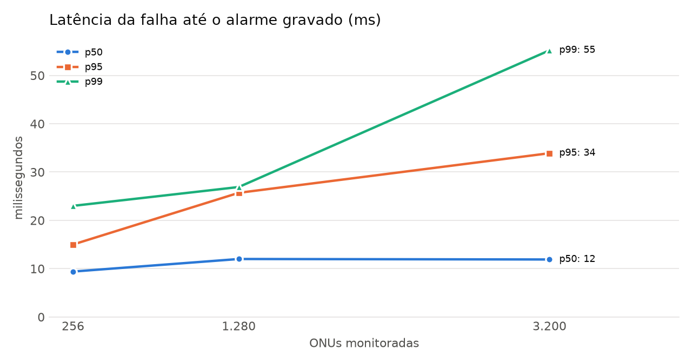
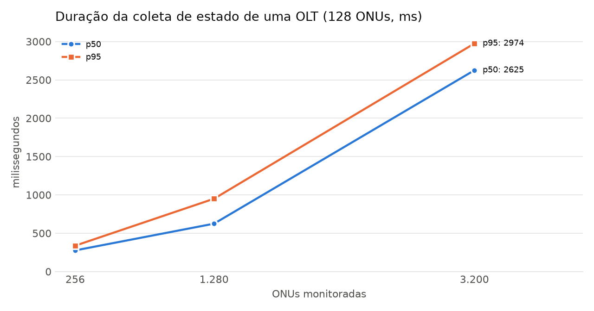
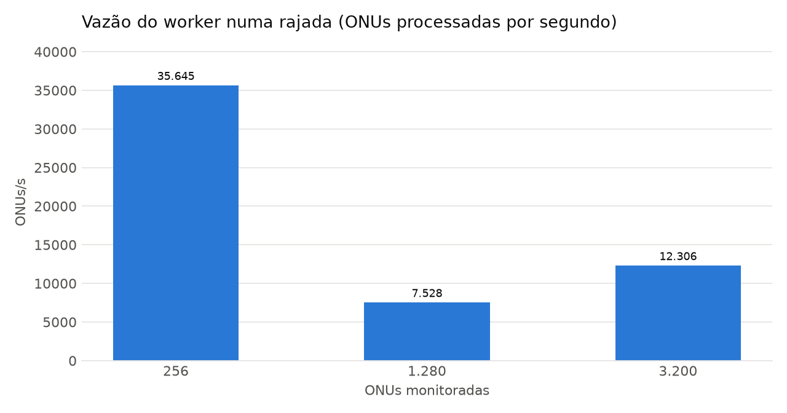
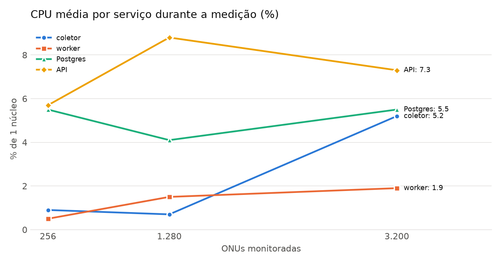
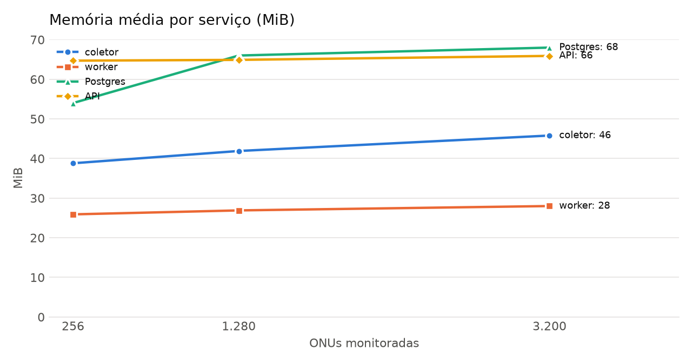

# Resultados: desempenho da Lumio

> Gerado por `scripts/bench/report.py` a partir de `scripts/bench/bench.sh`.
> Para refazer: `docker compose down && ./scripts/bench/bench.sh` (uns 20 minutos).

## Metodologia

**Ambiente.** Uma máquina só, com todos os serviços em contêineres Docker
(mesmo `docker-compose.yml` do desenvolvimento, sem ajustes de desempenho):

- CPU: 13th Gen Intel(R) Core(TM) i5-1334U
- Docker 29.9.2 (Docker Desktop), VM com 12 CPUs e 6051115008 bytes de RAM

**Carga.** O simulador de OLTs da sprint 1 sobe com N OLTs Huawei MA5800-X7,
cada uma com 4 portas PON e 32 ONUs por porta (128 ONUs). Foram medidos os
níveis de 2, 10, 25 OLTs (256, 1.280, 3.200 ONUs). Em cada nível:

1. um provedor novo é criado e as N OLTs são cadastradas pela API, como um
   usuário faria (com a descoberta de portas e ONUs);
2. espera-se todas as OLTs entrarem em coleta (o coletor relê o cadastro a
   cada 30 s); a coleta segue os intervalos padrão: estado a cada 60 s e
   potência óptica a cada 5 min;
3. **janela de medição**: 40 quedas de ONU, uma por segundo, em ONUs
   sorteadas (semente fixa), seguidas de 75 s de observação
   (pelo menos um ciclo completo de coleta). A **latência** de cada queda é o
   tempo entre o pedido ao simulador e a gravação do alarme no Postgres
   (`alarms.created_at`); todos os contêineres usam o relógio do host;
4. CPU e memória de cada contêiner são amostradas com `docker stats` durante
   todo o teste; as tabelas usam só as amostras de dentro da janela;
5. **rajada**: 200 registros de estado (128 ONUs cada) e depois o mesmo número
   de leituras de potência são injetados de
   uma vez na fila do Redis, e mede-se o tempo até o worker zerá-la. Isso dá a
   vazão máxima do worker, independente do simulador.

As OLTs de um nível são removidas antes do próximo, então a carga de cada
nível é só a dele. O simulador também roda na mesma máquina e disputa CPU
com a Lumio; o consumo dele aparece separado e não entra nos totais.

## Latência de alarme

Do pedido de falha ao simulador até o alarme gravado no banco. Inclui: o
simulador mudar o estado e mandar a trap SNMP, o coletor receber e publicar
no Redis, o worker consumir, aplicar as regras e gravar.

| ONUs | OLTs | quedas | sem alarme | p50 (ms) | p95 (ms) | p99 (ms) | máx. (ms) | coletor→banco p50 (ms) |
| --- | ---: | ---: | ---: | ---: | ---: | ---: | ---: | ---: |
| 256 | 2 | 40 | 0 | 9,4 | 15,0 | 23,0 | 28,0 | 5,3 |
| 1.280 | 10 | 40 | 0 | 12,0 | 25,7 | 26,9 | 27,5 | 5,0 |
| 3.200 | 25 | 40 | 0 | 11,9 | 33,9 | 55,2 | 67,3 | 6,4 |

## Coleta SNMP e vazão do worker

Duração da coleta de estado de uma OLT (128 ONUs, GETBULK) e a vazão do
worker na rajada.

| ONUs | coletas medidas | coleta p50 (ms) | coleta p95 (ms) | ONUs/s por OLT (p50) | rajada (s) | worker (registros/s) | worker (ONUs/s) | worker, potência (ONUs/s) |
| --- | ---: | ---: | ---: | ---: | ---: | ---: | ---: | ---: |
| 256 | 4 | 276 | 338 | 486 | 0,72 | 278,5 | 35.645 | 12.831 |
| 1.280 | 20 | 624 | 950 | 256 | 3,40 | 58,8 | 7.528 | 4.287 |
| 3.200 | 75 | 2.625 | 2.974 | 49 | 2,08 | 96,1 | 12.306 | 6.502 |

Para comparação: no maior nível, a coleta normal gera 53 estados de ONU por
segundo (todas as ONUs a cada 60 s).

## CPU e memória

Média dentro da janela de medição; CPU em % de um núcleo (100 % = um núcleo inteiro).

| ONUs | coletor CPU % | worker CPU % | Postgres CPU % | API CPU % | Lumio total CPU % | simulador CPU % |
| --- | ---: | ---: | ---: | ---: | ---: | ---: |
| 256 | 0,9 | 0,5 | 5,5 | 5,7 | 14,4 | 0,6 |
| 1.280 | 0,7 | 1,5 | 4,1 | 8,8 | 19,0 | 0,8 |
| 3.200 | 5,2 | 1,9 | 5,5 | 7,3 | 23,9 | 3,3 |

| ONUs | coletor MiB | worker MiB | Postgres MiB | API MiB | Redis MiB | notificador MiB | painel (nginx) MiB | Mailpit MiB | Lumio total MiB |
| --- | ---: | ---: | ---: | ---: | ---: | ---: | ---: | ---: | ---: |
| 256 | 39 | 26 | 54 | 65 | 5 | 38 | 12 | 22 | 260 |
| 1.280 | 42 | 27 | 66 | 65 | 9 | 38 | 12 | 22 | 280 |
| 3.200 | 46 | 28 | 68 | 66 | 13 | 38 | 12 | 22 | 292 |

## Cadastro

| ONUs | OLTs | descoberta por OLT p50 (ms) | descoberta p95 (ms) | até todas em coleta (s) |
| --- | ---: | ---: | ---: | ---: |
| 256 | 2 | 498 | 632 | 18 |
| 1.280 | 10 | 506 | 564 | 16 |
| 3.200 | 25 | 1.554 | 2.723 | 28 |

"Até todas em coleta" inclui a espera de até 30 s do coletor reler o cadastro.

## Antes e depois da otimização do worker

Mesmo nível, medido antes e depois de o worker passar a gravar o estado e a potência
das ONUs em lote (uma consulta por OLT em vez de uma por ONU).

| ONUs | medida | antes | depois | ganho |
| --- | ---: | ---: | ---: | ---: |
| 256 | rajada de estado (ONUs/s) | 1.473 | 35.645 | 24,2× |
| 256 | rajada de potência (ONUs/s) | 1.186 | 12.831 | 10,8× |
| 256 | latência de alarme p50 (ms) | 8,7 | 9,4 | — |

## Análise

**Latência de alarme.** Nenhuma das 120 quedas provocadas (40 por nível)
ficou sem alarme. A mediana ficou entre 9 e 12 ms em todos os níveis, e o
p99 subiu de 23 para 55 ms com 3.200 ONUs. Do coletor ao banco (Redis,
regras e gravação), o tempo ficou em ~5–6 ms. O resto é o simulador gerando a
trap e o coletor recebendo, o que mostra que o caminho da trap não é
gargalo. Na tela, o alarme aparece depois de mais ~0,1 s (SSE pelo nginx,
medido na sprint 4); o teste de ponta a ponta exige no máximo 5 s.

**Vazão do worker.** O primeiro teste mostrou que o worker fazia uma
consulta ao banco **por ONU** (1.473 ONUs/s). Depois da mudança para
gravação em lote, o mesmo teste deu **35.645 ONUs/s** (24× mais). Nos níveis
seguintes, a rajada ficou entre 7.500 e 12.300 ONUs/s. A variação não segue
o tamanho da rede (10 OLTs deu menos que 25), então é ruído de medição: cada
rajada dura 1 a 4 s, roda uma vez só, junto da coleta real das OLTs e numa
máquina compartilhada com o Windows e outros programas. Mesmo o **pior
valor medido (7.528 ONUs/s) é ~140 vezes** a carga normal do maior nível (53
estados de ONU por segundo). Num ciclo de 60 s, isso daria para ~450 mil
ONUs só pelo worker, bem acima de qualquer provedor regional.

**Coleta SNMP.** A coleta de uma OLT (128 ONUs) passou de 0,3 s para 2,6 s
com 25 OLTs. A causa provável é o **simulador**: um processo Python só
responde por todas as OLTs, então as coletas simultâneas fazem fila nele.
OLTs reais respondem cada uma por si. Mesmo assim, 2,6 s é bem menos que o
intervalo de 60 s entre coletas.

**CPU e memória.** Com 3.200 ONUs, a Lumio inteira usou em média **~24 % de
um núcleo e ~290 MiB de RAM**. Uma VPS de 2 vCPU e 4 GB (a sugerida em
`docs/deploy.md`) tem folga grande para o MVP.

**Limitações.**
- Um teste por nível, numa máquina só (o simulador disputa a CPU com a
  Lumio). Os números servem de ordem de grandeza, não de limite exato.
- O nível de 50 OLTs (6.400 ONUs) não foi medido: a máquina de teste ficou
  sem memória livre. Ele fica no script (`LEVELS="2 10 25 50"`, o padrão).
- O "antes" só tem o nível de 2 OLTs, medido antes da otimização.
- A latência não inclui o atraso de rede até OLTs reais, nem a detecção só
  por polling (sem trap), que depende do ciclo de 60 s.

